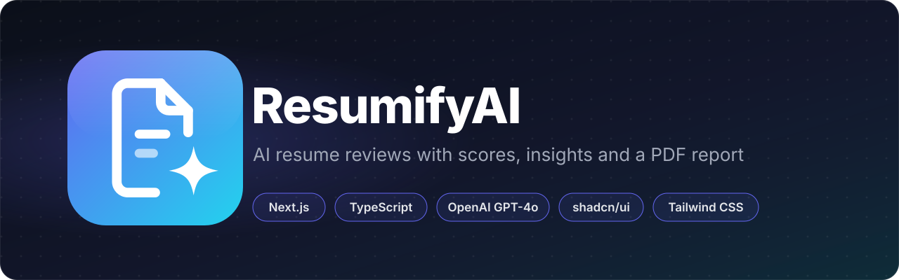
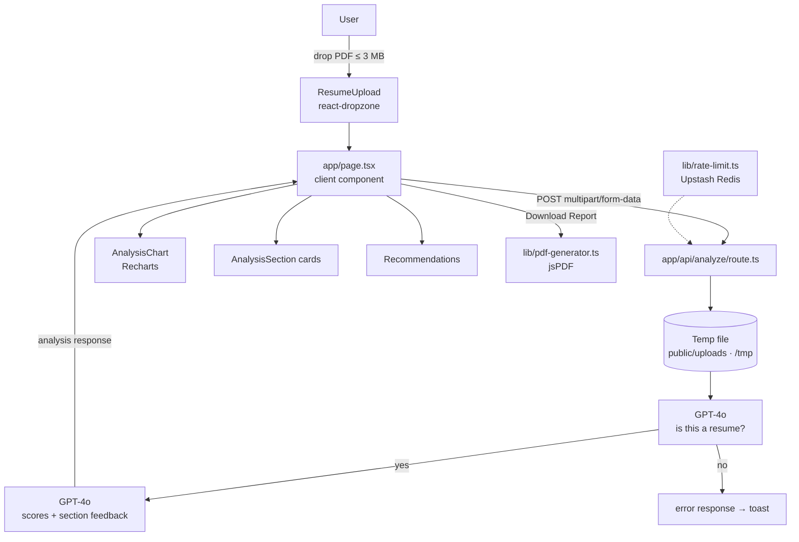

<div align="center">
  
  <p><b>Upload a PDF resume and get a GPT-4o review: section scores, strengths, concrete improvements and a downloadable report.</b></p>
  <p>
    
    
    
    
    
    <a href="LICENSE"></a>
    
    
    <a href="https://github.com/ismailbentabett/ResumifyAI/stargazers"></a>
    
  </p>
  <p><a href="#-quick-start">Quick start</a> · <a href="#-features">Features</a> · <a href="#-architecture">Architecture</a> · <a href="#-contributing">Contributing</a></p>
</div>

## Overview

**ResumifyAI** is a Next.js web app that reviews resumes with OpenAI's GPT-4o. You drop a PDF on the page, a server route first checks that the document really is a resume, then asks the model for a structured critique: a 0–100 score per dimension, strengths and improvements for each section, and a list of recommendations. The results are shown as an interactive dashboard with charts and can be exported as a PDF report.

The UI is built with shadcn/ui and Tailwind CSS, uses an orange accent palette with glassmorphism-style cards, and supports light, dark and system themes.

## ✨ Features

- **Drag-and-drop upload** – `react-dropzone` accepts a single PDF up to 3 MB, with a progress indicator while the file is processed.
- **Resume validation** – a first GPT-4o call rejects documents that are not resumes before any analysis is spent on them.
- **Structured AI review** – GPT-4o scores the resume from 0 to 100 on *Overall*, *Experience*, *Education*, *Skills*, *Projects*, *Impact* and *Format*.
- **Section feedback** – strengths and improvements for Experience, Education, Skills, Projects, Impact and Format, each rendered as its own card.
- **Actionable recommendations** – a prioritised list of next steps to strengthen the resume.
- **Score charts** – Recharts bar, line and pie views of the section scores, switchable with tabs.
- **PDF export** – "Download Report" generates `resume-analysis.pdf` client-side with jsPDF.
- **Light / dark / system themes** – powered by `next-themes`, with toast notifications via `sonner`.
- **Temporary file handling** – uploads are written to a temp location (`public/uploads` in development, `/tmp` in production) and deleted after analysis.
- **SEO ready** – page metadata, `robots.txt` and `sitemap.xml` are included; Vercel Analytics is wired into the root layout.

## 🧱 Tech stack

| Layer          | Technology                                                        |
|----------------|-------------------------------------------------------------------|
| Framework      | Next.js 13.5 (App Router), React 18                               |
| Language       | TypeScript 5.2                                                    |
| AI             | OpenAI Node SDK v4, model `gpt-4o`                                |
| UI components  | shadcn/ui (Radix UI primitives), lucide-react icons               |
| Styling        | Tailwind CSS 3.3, `tailwindcss-animate`, `next-themes`            |
| Charts         | Recharts                                                          |
| Upload         | `react-dropzone`                                                  |
| PDF export     | jsPDF                                                             |
| Rate limiting  | Upstash Redis + `@upstash/ratelimit` (fixed window, 3 req / hour) |
| Analytics      | `@vercel/analytics`                                               |
| Tooling        | ESLint (`eslint-config-next`), PostCSS, Autoprefixer              |

## 🏗 Architecture



```
app/
├── api/analyze/route.ts   # Upload handling, validation + analysis calls to GPT-4o
├── banner/page.tsx        # Promotional banner page
├── layout.tsx             # Fonts, theme provider, navbar, footer, toaster, analytics, SEO metadata
└── page.tsx               # Upload flow and results dashboard
components/
├── analysis-chart.tsx     # Score charts (bar / line / pie)
├── analysis-section.tsx   # Strengths + improvements card
├── resume-upload.tsx      # Dropzone with progress
└── ui/                    # shadcn/ui primitives
lib/
├── pdf-generator.ts       # jsPDF report export
└── rate-limit.ts          # Upstash fixed-window limiter
```

## 🚀 Quick start

### Prerequisites

- [Node.js](https://nodejs.org/) 18 or newer and npm
- An [OpenAI API key](https://platform.openai.com/api-keys) with access to `gpt-4o`
- An [Upstash Redis](https://upstash.com/) database (REST URL and token); the free tier is enough for development

### Run locally

```bash
git clone https://github.com/ismailbentabett/ResumifyAI.git
cd ResumifyAI
npm install
cp .example.env .env.local   # then fill in the values, see Configuration
npm run dev
```

Open [http://localhost:3000](http://localhost:3000) and drop a PDF resume onto the upload area.

### Production build

```bash
npm run build
npm run start
```

### Scripts

| Script          | Description                       |
|-----------------|-----------------------------------|
| `npm run dev`   | Start the development server      |
| `npm run build` | Create an optimised production build |
| `npm run start` | Serve the production build        |
| `npm run lint`  | Run ESLint (`next lint`)          |

## ⚙️ Configuration

Configuration is read from environment variables. Copy `.example.env` to `.env.local` (git-ignored) and set the following:

| Variable                   | Required | Description                                                                                         |
|----------------------------|----------|-----------------------------------------------------------------------------------------------------|
| `OPENAI_API_KEY`           | Yes      | OpenAI key used server-side by `/api/analyze`. Not yet listed in `.example.env`; add it manually.   |
| `UPSTASH_REDIS_REST_URL`   | Yes      | Upstash Redis REST endpoint. `lib/rate-limit.ts` throws on startup if it is missing.               |
| `UPSTASH_REDIS_REST_TOKEN` | Yes      | Upstash Redis REST token. `lib/rate-limit.ts` throws on startup if it is missing.                  |
| `GOOGLE_CREDENTIALS`       | No       | Listed in `.example.env` but not currently read by the application code.                           |
| `GOOGLE_PROJECT_ID`        | No       | Listed in `.example.env` but not currently read by the application code.                           |

> [!IMPORTANT]
> Keep `OPENAI_API_KEY` server-side only. Do not prefix it with `NEXT_PUBLIC_`, which would expose it to the browser.

## 📁 Project structure

```
ResumifyAI/
├── app/                 # App Router pages, layout and the /api/analyze route
├── components/          # Feature components and shadcn/ui primitives (components/ui)
├── hooks/               # use-toast hook
├── lib/                 # PDF export, rate limiter, class-name utils
├── public/              # Banner images, robots.txt, sitemap.xml
├── .github/             # Branding assets, issue and PR templates
├── .example.env         # Environment variable template
├── components.json      # shadcn/ui configuration
├── tailwind.config.ts   # Tailwind theme
├── next.config.js
├── CONTRIBUTING.md
├── SECURITY.md
└── LICENSE
```

## 🗺 Roadmap

- [x] PDF upload with size and type checks
- [x] GPT-4o resume validation and multi-dimension scoring
- [x] Charts, section feedback cards and PDF report export
- [x] Light / dark / system themes
- [ ] Extract PDF text with `pdf-parse` before sending it to the model (the route currently reads the file as UTF-8 text)
- [ ] Return the analysis as typed JSON (zod-validated, OpenAI JSON mode) matching the dashboard's `AnalysisResult` shape
- [ ] Enforce the Upstash rate limiter in `/api/analyze` per client IP
- [ ] Add `OPENAI_API_KEY` to `.example.env` and drop the unused `GOOGLE_*` variables
- [ ] Process uploads in memory instead of writing to `public/uploads`
- [ ] Unit tests for the PDF generator and an end-to-end test of the upload flow
- [ ] Support DOCX resumes

## 🤝 Contributing

Contributions are welcome. Please read [CONTRIBUTING.md](CONTRIBUTING.md) for the development setup, branch naming and commit conventions, and follow the [Code of Conduct](CODE_OF_CONDUCT.md).

## 🔒 Security

Please report vulnerabilities privately as described in [SECURITY.md](SECURITY.md). Do not open public issues for security problems, and never commit API keys or `.env` files.

## 📄 License

Released under the [MIT License](LICENSE).

---

<div align="center">
  <p>Built by <b>Ismail Bentabett</b> · <a href="https://github.com/ismailbentabett">GitHub</a> · <a href="https://ismailbentabett.com">ismailbentabett.com</a></p>
  <p>⭐ Star this repo if you find it useful</p>
</div>
