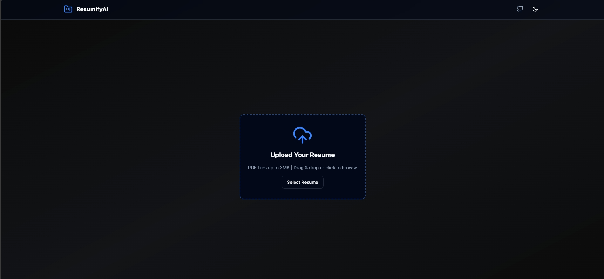

# ResumifyAI 🚀

ResumifyAI is your AI-powered resume assistant, designed to analyze, optimize, and elevate your career prospects! Built with **Next.js** and **OpenAI**, this cutting-edge web app provides personalized insights to transform your resume into a job-winning document. 🎯

## 🌟 Features

- **✨ AI-Powered Insights**: Harness the power of **OpenAI** for personalized resume recommendations.  
- **🔍 Resume Evaluation**: Pinpoints strengths and areas for improvement across key sections.  
- **📊 Visual Feedback**: Dive into clear, interactive charts and metrics to better understand your resume's performance.  
- **🌗 Dark & Light Modes**: Enjoy a sleek, user-friendly design with **glassmorphism** aesthetics.  
- **🎨 Interactive Visuals**: Leveraging **HTML Canvas**, ResumifyAI brings your resume insights to life with dynamic visuals.

---

## 🛠️ Tech Stack

- **Framework**: [Next.js](https://nextjs.org/)  
- **AI Integration**: [OpenAI API](https://platform.openai.com/)  
- **Frontend**: HTML Canvas for interactive visuals  
- **Design**: Glassmorphism with a modern **orange** color palette  

---

## 🚀 Getting Started

### 1️⃣ Clone the Repository  

```bash
git clone https://github.com/ismailbentabett/ResumifyAI.git
```

### 2️⃣ Navigate to the Project Folder  

```bash
cd ResumifyAI
```

### 3️⃣ Install Dependencies  

```bash
npm install
```

### 4️⃣ Configure API Keys  

- Obtain your **OpenAI API key** from [OpenAI](https://platform.openai.com/).
- Create a `.env.local` file and add your API key:  

  ```env
  NEXT_PUBLIC_OPENAI_API_KEY=your_openai_api_key
  ```

### 5️⃣ Start the Application  

```bash
npm run dev
```

The app will be available at [http://localhost:3000](http://localhost:3000). 🌐  

---

## 🎉 How to Use  

1. **Upload Your Resume** 📄: Upload your resume in **PDF format**.  
2. **AI Analysis** 🤖: Let the AI work its magic and provide actionable feedback.  
3. **Visualize Metrics** 📊: Understand your resume's performance with intuitive charts.  
4. **Improve & Optimize** 🔧: Apply tailored recommendations to refine your resume.

---

## 🤝 Contributing  

We ❤️ contributions!  
- **🛠️ Found an issue?** Open one [here](https://github.com/ismailbentabett/ResumifyAI/issues).  
- **🚀 Got improvements?** Fork the repo and submit a pull request!  

---

## 📜 License  

This project is licensed under the [MIT License](./LICENSE).  

---

## 👏 Acknowledgments  

- **OpenAI** for powering the AI engine 🤖.  
- **Next.js** for the blazing-fast framework ⚡.  

---

## 🖼️ Sneak Peek  


